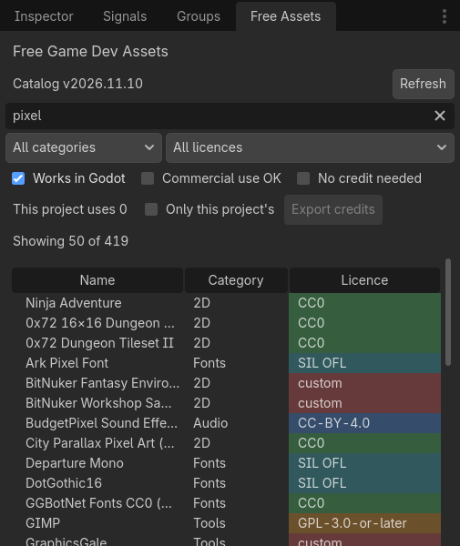
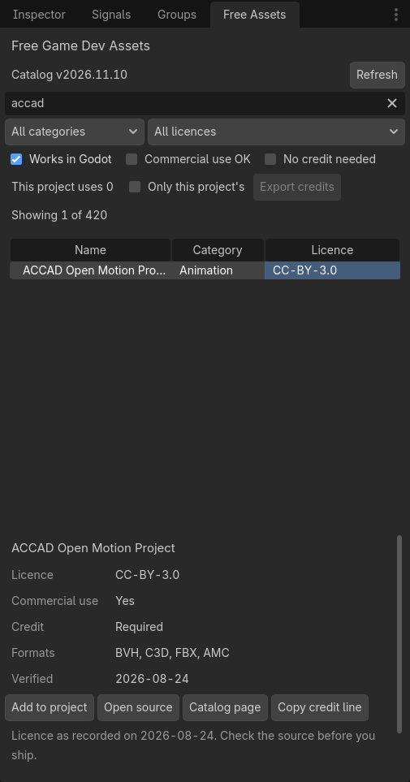
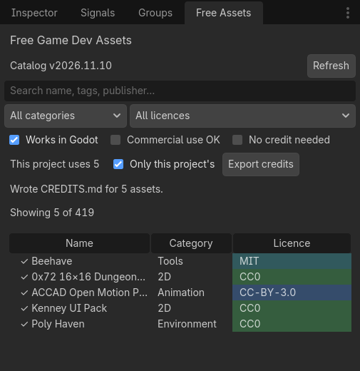

# Free Game Dev Assets for Godot

**The Free Game Dev Assets catalog inside the Godot editor: find free assets and tools, with each licence shown on every row.**

[**Install**](#install)  ·  [What it does](#what-it-does)  ·  [Credits for your project](#credits-for-your-project)  ·  [Privacy](#what-it-sends-over-the-network)  ·  [The catalog](https://tmhsdigital.github.io/Free-Game-Dev-Assets/)  ·  [Changelog](CHANGELOG.md)

The dock in Godot 4.7, searching for "pixel". The licence is written on every row; the colour only groups licence families.

The [Free Game Dev Assets](https://github.com/TMHSDigital/Free-Game-Dev-Assets) catalog records,
for each free asset source and tool, what its licence says, where it says it and when someone last
read it there. This plugin puts that catalog in a dock in the Godot editor, so you can check a
licence without leaving the editor, and keep track of what your project uses and what it owes.

The plugin never downloads, rehosts or imports assets. It shows the catalog's records and links
to the source.

> [!NOTE]
> The plugin shows the catalog's reading of each licence, not legal advice. Licences change:
> read the source's own terms before you ship.

## Install

Godot 4.3 or later.

1. Download the latest release from
   [Releases](https://github.com/TMHSDigital/free-game-dev-assets-godot/releases/latest). The
   archive holds only `addons/free_game_dev_assets/`.
2. Copy that folder into your project's `addons/` folder.
3. Turn it on under **Project → Project Settings → Plugins**. The **Free Assets** dock appears
   on the right.

To update, replace the folder with the new release's. Your asset list and `CREDITS.md` live in
your project, not in the folder, so they are kept. [CHANGELOG.md](CHANGELOG.md) says what changed.

## What it does

- **Browse** the catalog in a **Free Assets** dock, entries made for Godot first.
- **Search** by name, tags, publisher and summary.
- **Filter** by category, licence family, commercial use, "no credit needed" and "works in Godot"
  (on by default). The filters are kept between editor sessions.
- **See the licence on every row** as text, on a background coloured by licence family, with
  entries still under review marked.
- **Select an entry** to see its licence and SPDX id, commercial use, credit, formats and the date
  the licence was read, and to:
  - open its source, or its catalog page where the licence is quoted (only `https://` links are
    opened);
  - copy the recorded credit line, the same text the catalog page shows.
- **Work offline** from a saved copy of the catalog.

Copy credit line is turned off, with the reason shown, when there is no line to copy.

## Credits for your project

Select an entry and press **Add to project**; rows your project uses get a ✓, and **Only this
project's** shows just those. **Export credits** then writes what they owe into `CREDITS.md` at
the root of your project: credit lines to ship, licence notices to keep with the files, sources
to check file by file, open questions, and the ones that need nothing.

- **Same wording as the website.** The sections and lines are the website's shortlist export,
  ported line for line; CI runs both on the whole live catalog and fails if they differ. Each
  entry links to its catalog page, and the file names the catalog version it was made from.
- **Your text is kept.** The plugin writes only between
  `<!-- free-game-dev-assets:start -->` and `<!-- free-game-dev-assets:end -->`. Write your own
  credits above or below. Exporting again with nothing changed leaves the file as it is.
- **Nothing is dropped silently.** If the catalog stops listing an entry you use, the export
  keeps it under **No longer listed**, with the name, licence and credit line from when the
  plugin last saw it, and asks you to check the licence.
- **The list is a file in your project**, `free_game_dev_assets.json`. Commit it with
  `CREDITS.md` so your team works from the same list. If either file is damaged (broken JSON, a
  missing marker), the plugin says what's wrong and doesn't overwrite it.

## What it sends over the network

One request, to
[`plugin-feed.json`](https://tmhsdigital.github.io/Free-Game-Dev-Assets/plugin-feed.json) on the
catalog's GitHub Pages site. Nothing about you or your project is sent.

- **How often:** when the dock opens, at most once a day, or when you press **Refresh**. Within a
  day the saved copy is used and no request is made.
- **What it sends:** a plain `GET` with a `User-Agent` naming this plugin, plus the
  `If-None-Match` / `If-Modified-Since` validators from the last download, so an unchanged
  catalog comes back as an empty `304`.
- **Where it saves things:** the catalog goes in the editor's cache folder and the filter
  settings in the editor's config folder. The only files it writes in your project are
  `free_game_dev_assets.json` and `CREDITS.md`, and only when you add an asset or export.
- **When it can't connect:** it uses the saved copy and says why. A server error, a Wi-Fi login
  page or a catalog format newer than the plugin understands never replaces a good saved copy.

## Requirements

Godot 4.3 or later. GDScript only: no GDExtension, no C#, nothing to compile. Every change is
tested on Godot 4.3 and the latest stable release, including a clean install into a fresh
project.

## Contributing

Bug reports and ideas go in the
[catalog repository's issues](https://github.com/TMHSDigital/Free-Game-Dev-Assets/issues). To
correct a licence or add a source, change the catalog itself; the plugin picks it up on the next
deploy. For changes to the plugin, [CONTRIBUTING.md](CONTRIBUTING.md) covers the layout, the
tests and the screenshot tool.

## Support

If the catalog or the plugin saves you time, you can
[sponsor TMHSDigital on GitHub](https://github.com/sponsors/TMHSDigital). Entirely optional.

<a href="#free-game-dev-assets-for-godot">Back to top ↑</a>

## Licence

Plugin code: [MIT](LICENSE). Catalog data: [CC0 1.0](https://github.com/TMHSDigital/Free-Game-Dev-Assets/blob/main/LICENSE).
The assets the catalog lists keep their own licences: check the source before you ship.
